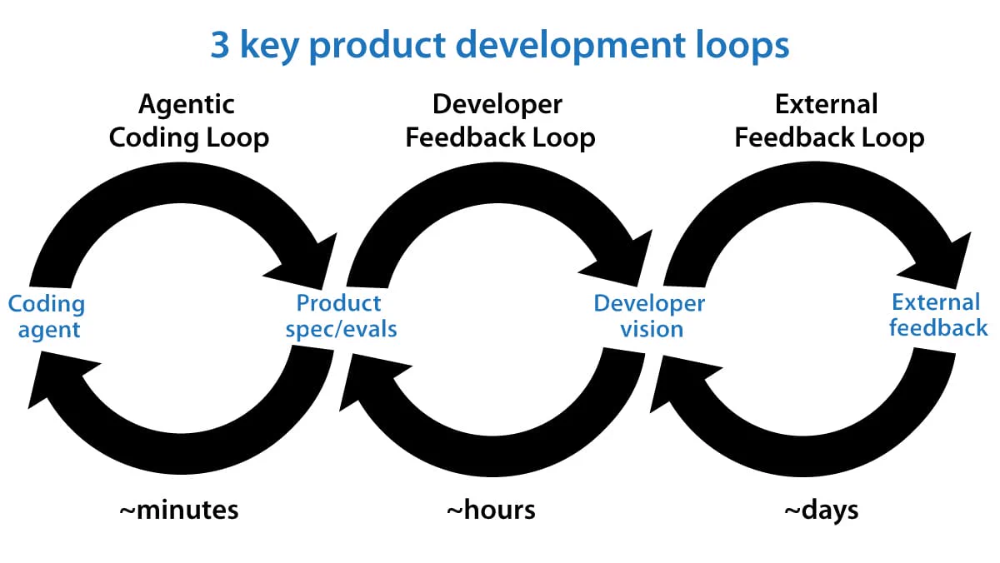

By [Andrew Ng](https://x.com/AndrewYNg/status/2071988145667928442)

作者：[Andrew Ng（吴恩达）](https://x.com/AndrewYNg/status/2071988145667928442)

“Loop engineering” is a hot buzzphrase after mentions of it by Boris Cherny (Claude Code’s creator) and Peter Steinberger (OpenClaw's creator) went viral on social media. Loops are now a key part of how we get AI agents to iterate at length to build software. In this letter, I’d like to share my 3 key loops, shown in the image below, for building 0-to-1 products. These loops guide not just how I build software, but also how I decide what software to build.

在 Boris Cherny（Claude Code 的创造者）和 Peter Steinberger（OpenClaw 的创造者）提到“循环工程”（Loop Engineering）的内容在社交媒体上广泛传播后，这个词成了热门术语。如今，循环已成为让 AI 智能体持续迭代、构建软件的关键。在这封信中，我想分享构建从 0 到 1 的产品时所用的三个关键循环，如下图所示。这些循环不仅指导我如何构建软件，也指导我决定要构建什么软件。

<!-- more -->

Agentic coding loop: Given a product specification and optionally a set of evals (that is, a dataset against which to measure performance), we can have an AI agent write code, test its work, and keep iterating until the code is bug-free and meets its specification. This idea of closing the loop took off around the end of last year, and it has been a game changer in enabling coding agents to work longer productively without human intervention. For example, over the weekend, I was building an app for my daughter to practice typing, and my coding agent could easily work for around an hour, using a web browser to check what it had built multiple times before getting back to me, without needing my intervention.

智能体编码循环：给定一份产品规格说明，以及一组可选的评估集（evals，即用于衡量性能的数据集），我们就可以让 AI 智能体编写代码、测试自己的工作成果，并持续迭代，直到代码没有缺陷且符合规格要求。这种闭环思路大约在去年年底开始流行，它带来了重大改变：编码智能体能够在无人干预的情况下，更长时间地高效工作。例如，周末我在为女儿制作一款练习打字的应用，编码智能体可以轻松地连续工作一个小时左右，在向我汇报之前，多次使用浏览器检查自己构建的应用，整个过程都不需要我介入。

The engineering loop executes quickly. Every few minutes, the coding agent might build and test a new version of the software. I hear frequently from developers who are finding new ways to engineer more effective engineering loops. This is an active area of invention!

工程循环的执行速度很快。编码智能体可能每隔几分钟就构建并测试一个新的软件版本。我经常听到开发者分享他们找到的新方法，用来设计更有效的工程循环。这是一个创新十分活跃的领域！

Developer feedback loop: In this loop, a developer examines the current product and steers the coding agent to improve it. Last year, a lot of developers (including me) were acting as the QA (quality assurance) function for our coding agents, manually finding bugs and then asking the agent to fix them. But with coding agents much more able to test their own code, the amount of time we need to spend on this function has decreased significantly. This allows us to make higher-level product decisions, such as what key features to offer, where the UI needs improvement, and so on.

开发者反馈循环：在这个循环中，开发者检查当前产品，并引导编码智能体进行改进。去年，许多开发者（包括我在内）都在为自己的编码智能体承担 QA（质量保证）工作：手动找出缺陷，再让智能体修复。但随着编码智能体测试自身代码的能力大幅增强，我们需要投入这项工作的时间已经显著减少。这让我们能够做出更高层次的产品决策，例如应该提供哪些关键功能、用户界面有哪些地方需要改进，等等。

The developer-feedback loop operates over time intervals between tens of minutes and hours — that's how frequently a developer might review a product and give feedback. In the case of the typing app, I changed my mind a few times about the visual design, what cat costumes she can unlock as she learns (she loves cats), and the user flow for a grown-up to log in and steer the child's learning experience.

开发者反馈循环的时间间隔从几十分钟到几小时不等——开发者可能以这样的频率审查产品并提供反馈。以那款打字应用为例，我曾几次调整自己的想法，包括视觉设计、女儿在学习过程中可以解锁哪些猫咪装扮（她很喜欢猫），以及成年人登录并引导孩子学习体验的操作流程。

When a developer has a clear vision for what to build, it is still a lot of work to translate that vision into a specification for a coding agent to implement. Further, after the developer has seen an implementation, they might update (or perhaps clarify) the spec to steer it toward what they want. If you find that the system repeatedly runs into certain problems, building a set of evals for the agent becomes useful.

即使开发者已经清楚自己想构建什么，把这一愿景转化为可供编码智能体实现的规格说明，仍然需要大量工作。此外，在看到具体实现后，开发者可能会更新（或进一步澄清）规格说明，使实现结果更接近自己的预期。如果你发现系统反复遇到某些问题，那么为智能体构建一组评估集就会很有帮助。

AI-native teams are increasingly using AI to help shape product direction, for example, automating the gathering and analysis of usage data, summarizing written and verbal customer feedback, or carrying out competitive analysis. However, for pretty much all the products I’m involved in, I see humans as having a significant context advantage over current AI systems — we know a lot more than the AI system about the users and the context the product has to operate in — and thus humans play a critical role. Many people describe this human contribution as “taste,” but I prefer to think of it as humans having a context advantage, since that gives us a clearer path to helping AI systems get better. This also speaks to why this step can’t be automated: So long as the human knows something the AI does not, human-in-the-loop is needed to to inject that knowledge into the system.

AI 原生团队正越来越多地使用 AI 来帮助确定产品方向，例如自动收集和分析使用数据、总结客户的书面及口头反馈，或开展竞品分析。然而，在我参与的几乎所有产品中，我都认为人类相较于当前的 AI 系统具有显著的上下文优势——我们对用户以及产品所处的使用环境，了解得比 AI 系统多得多——因此，人类发挥着关键作用。许多人把人类的这种贡献称为“品味”，但我更愿意将其理解为人类具有上下文优势，因为这能为帮助 AI 系统进步提供更清晰的路径。这也解释了为什么这一步无法自动化：只要人类知道某些 AI 不知道的事情，就需要让人类参与循环，将这些知识注入系统。

External feedback loop: This includes a wide range of tactics like asking a few friends for feedback, launching to alpha testers, or putting the code into production with A/B testing. These tactics are usually slow, rarely taking less than hours and sometimes taking days or even weeks. This data informs the developer vision, which in turn continues to drive the detailed product spec, which in turn drives the coding agent.

外部反馈循环：这个循环涵盖多种方法，例如邀请几位朋友提供反馈、向 alpha 测试用户发布产品，或将代码部署到生产环境并开展 A/B 测试。这些方法通常比较慢，很少能在几小时以内完成，有时需要几天甚至几周。由此获得的数据为开发者的愿景提供依据，而愿景又持续指导详细产品规格的制定，产品规格进而指导编码智能体的工作。

With coding agents speeding up software development, more engineers are starting to play a partial product management role. For many engineers who are growing into this role, the hardest part is shaping the product vision and striking a balance between building (bridging the gap between vision and spec) and getting user feedback to evolve the vision. It is important to do both!

随着编码智能体加快软件开发的速度，越来越多的工程师开始承担一部分产品管理职责。对于许多正在适应这一角色的工程师来说，最难的是形成产品愿景，并在构建产品（弥合愿景与规格说明之间的差距）和获取用户反馈以完善愿景之间取得平衡。这两件事都很重要！

I will write more about how to do this in future posts, but for now, I find it encouraging that engineers are playing an expanded role (just as product managers and designers now do more engineering).

我会在以后的文章中进一步介绍具体做法。但就目前而言，工程师正在承担更广泛的职责，这让我感到鼓舞（正如产品经理和设计师如今也在承担更多工程工作一样）。

[Original text: The Batch]

[原文：The Batch]

